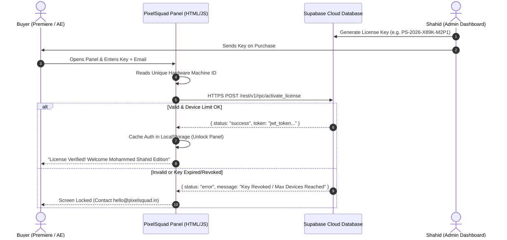

# 🔐 PixelSquad Supabase License & Remote Management Architecture

**Prepared for:** Mohammed Shahid  
**Product:** PixelSquad Premiere Pro & After Effects Master Suites  
**Target Backend:** Supabase (PostgreSQL + REST API)  

---

## 1. Executive Advice: "Karne Ki Zaroorat Hai Kya?"

> [!IMPORTANT]
> **Verdict: YES, definitely recommended if you are selling commercially.**  
> Agar aap offline serial key denge toh 1 banda key kharid kar poore Telegram ya dosto mein baat dega. **Supabase use karne se 1 License = 1 Machine lock ho jata hai**, jisse piracy 99% ruk jati hai. Aur Supabase ka **Free Tier** 50,000 users tak bilkul free hai.

---

## 2. Supabase Architecture Overview



---

## 3. Supabase Database Schema (SQL Ready-to-Run)

Aap Supabase Dashboard mein SQL Editor open karke yeh table create kar sakte hain:

```sql
-- 1. Create Licenses Table
CREATE TABLE public.pixelsquad_licenses (
    id UUID PRIMARY KEY DEFAULT gen_random_uuid(),
    license_key TEXT UNIQUE NOT NULL,
    buyer_name TEXT NOT NULL,
    buyer_email TEXT NOT NULL,
    product_tier TEXT DEFAULT 'All-in-One Master Suite',
    status TEXT DEFAULT 'active' CHECK (status IN ('active', 'revoked', 'expired')),
    max_devices INT DEFAULT 1,
    activated_devices JSONB DEFAULT '[]'::jsonb,
    created_at TIMESTAMP WITH TIME ZONE DEFAULT NOW(),
    last_verified_at TIMESTAMP WITH TIME ZONE
);

-- 2. Create RPC Function to Safely Activate License
CREATE OR REPLACE FUNCTION public.activate_pixelsquad_license(
    p_license_key TEXT,
    p_email TEXT,
    p_machine_id TEXT,
    p_machine_name TEXT
) RETURNS JSONB LANGUAGE plpgsql SECURITY DEFINER AS $$
DECLARE
    v_lic RECORD;
    v_devices JSONB;
BEGIN
    SELECT * INTO v_lic FROM public.pixelsquad_licenses 
    WHERE license_key = p_license_key AND LOWER(buyer_email) = LOWER(p_email);

    IF NOT FOUND THEN
        RETURN jsonb_build_object('success', false, 'message', 'Invalid License Key or Email.');
    END IF;

    IF v_lic.status != 'active' THEN
        RETURN jsonb_build_object('success', false, 'message', 'This license is ' || v_lic.status || '. Contact hello@pixelsquad.in');
    END IF;

    v_devices := v_lic.activated_devices;

    -- Check if machine already activated
    IF v_devices @> jsonb_build_array(jsonb_build_object('machine_id', p_machine_id)) THEN
        UPDATE public.pixelsquad_licenses SET last_verified_at = NOW() WHERE id = v_lic.id;
        RETURN jsonb_build_object('success', true, 'message', 'Device already activated.', 'buyer', v_lic.buyer_name);
    END IF;

    -- Check device limit
    IF jsonb_array_length(v_devices) >= v_lic.max_devices THEN
        RETURN jsonb_build_object('success', false, 'message', 'Device activation limit exceeded (Max ' || v_lic.max_devices || ').');
    END IF;

    -- Add new device
    v_devices := v_devices || jsonb_build_object('machine_id', p_machine_id, 'device_name', p_machine_name, 'activated_at', NOW());
    UPDATE public.pixelsquad_licenses 
    SET activated_devices = v_devices, last_verified_at = NOW() 
    WHERE id = v_lic.id;

    RETURN jsonb_build_object('success', true, 'message', 'License activated successfully!', 'buyer', v_lic.buyer_name);
END;
$$;
```

---

## 4. Frontend Activation UI (How it looks in Premiere / AE)

Jab tak user valid key nahi dalta:
- Main panel content `display: none` rehta hai.
- Ek dark-mode lockscreen popup rehta hai:
  - Input: License Key (`PS-XXXX-XXXX`)
  - Input: Buyer Email (`buyer@gmail.com`)
  - Button: `Activate PixelSquad Suite`
  - Link: `Need a key? Visit pixelsquad.in`
- Jaise hi activate ho jata hai, local storage mein encrypted token save ho jata hai taaki offline hone par bhi roz roz key na maange (30 days offline grace period).

---

## 5. Next Implementation Steps
Agar aap chahein toh hum agle step mein:
1. Dono extension panels (`PixelSquad-Studio` aur `PixelSquad-Motion-Studio`) mein yeh **Activation Lockscreen Modal** add kar sakte hain.
2. Supabase client connection code config file (`license_config.js`) ke through link kar sakte hain jisme aapka Supabase URL aur Anon Key set hoga.
